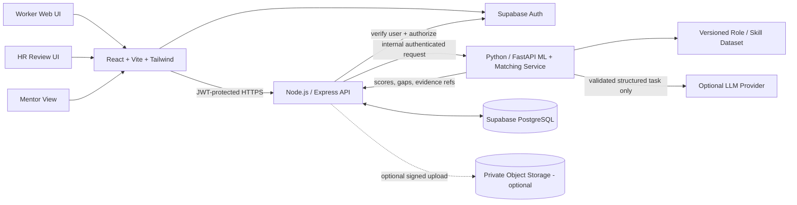

# Second Act — System Design

**Version:** Prototype architecture proposal  
**Design principle:** Small, auditable services; deterministic decisions; human control.

---

## 1. Architecture overview

The system is a web application with a thin API/orchestration layer and a Python service for skill extraction support, embeddings, and adjacency calculations. The MVP does not need a graph database or six autonomous agents. The role-skill graph can be represented with relational tables and queried in Python/SQL. Add infrastructure only when it proves a measurable need.

### Responsibility boundaries

- **Frontend:** collects inputs, displays evidence and explanations, handles user corrections, and requests actions. It never decides permissions or computes authoritative fit scores.
- **Supabase Auth:** manages sign-in and identity. Do not write a custom password system.
- **Express API:** verifies authentication, applies object-level authorization and consent checks, validates requests, reads/writes application data, and orchestrates ML calls.
- **FastAPI service:** normalizes skills, creates embeddings, runs deterministic ranking and gap calculations, validates model outputs, and returns structured results. It is not exposed directly to the public internet if deployment allows.
- **PostgreSQL:** stores versioned skills, roles, worker evidence, recommendations, assessments, mentors, opportunities, consent, and audit events.
- **Optional LLM:** suggests structured candidate skills or grounded text; it does not query the database, make external actions, change permissions, or own the ranking formula.
- **Optional file storage:** private bucket only; the MVP may use pasted text and seeded profiles to avoid upload complexity.

## 2. Recommended deployment for mentor evaluation

- **Frontend:** Vercel or another static frontend host.
- **Database and identity:** Supabase PostgreSQL + Supabase Auth; private Storage only if needed.
- **Express and FastAPI:** deploy as private/internal services where supported, or behind a single controlled HTTPS backend entry point. Restrict ML-service calls using a service credential and network policy when available.
- **Demo environment:** separate project/database from any personal or production data; seed synthetic profiles and mentors.
- **Configuration:** distinct development and demo environment variables; secrets stored in host secret storage, never in source code or frontend environment variables.

A successful mentor prototype is not automatically production-grade. Before real CVs or employer records are handled, perform security testing, privacy review, logging/retention review, and operational monitoring.

## 3. Core data model

Use UUID primary keys, timestamps, foreign keys, and version identifiers. Enforce authorization at both the API and database levels where practical.

### Main tables

| Table | Important fields | Purpose |
|---|---|---|
| `profiles` | `id`, `auth_user_id`, `display_name`, `experience_summary`, `preferences_json`, `consent_version`, `created_at`, `deleted_at` | Minimal worker identity and preferences |
| `skills` | `id`, `canonical_name`, `definition`, `aliases`, `taxonomy_source`, `taxonomy_version` | Canonical skill catalogue |
| `worker_skills` | `id`, `profile_id`, `skill_id`, `proficiency`, `status`, `evidence_text`, `evidence_source`, `confidence`, `user_confirmed`, `updated_at` | Skill claims and evidence provenance |
| `roles` | `id`, `title`, `domain`, `seniority`, `region`, `source`, `source_version`, `last_verified_at` | Target roles |
| `role_skill_requirements` | `role_id`, `skill_id`, `importance_weight`, `required_proficiency`, `is_mandatory`, `evidence_rubric`, `source` | Explicit skill requirements |
| `recommendations` | `id`, `profile_id`, `role_id`, `fit_score`, `score_breakdown_json`, `critical_gaps_json`, `unknowns_json`, `constraints_json`, `dataset_version`, `scoring_version`, `created_at` | Reproducible ranked recommendations |
| `learning_resources` | `id`, `skill_id`, `title`, `url`, `format`, `cost_band`, `source_checked_at`, `verified` | Grounded resources catalog |
| `assessments` | `id`, `skill_id`, `task`, `rubric_json`, `pass_threshold`, `version` | Fixed assessment definitions |
| `assessment_results` | `id`, `profile_id`, `assessment_id`, `result`, `rubric_scores_json`, `evidence_ref`, `reviewer_type`, `created_at` | Evidence that a skill was assessed |
| `mentor_profiles` | `id`, `display_name`, `skill_ids`, `role_experience`, `languages`, `availability`, `capacity`, `verification_status`, `is_synthetic` | Demo or consented mentor data |
| `mentor_requests` | `id`, `profile_id`, `mentor_id`, `shared_fields`, `consent_at`, `status`, `created_at` | Consent-based mentor contact request |
| `opportunities` | `id`, `role_id`, `employer`, `location`, `salary_range`, `source_url`, `source_type`, `last_checked_at`, `status`, `is_simulated` | Separates roles from vacancies |
| `consent_events` | `id`, `profile_id`, `purpose`, `consent_version`, `granted`, `created_at`, `revoked_at` | Consent history |
| `audit_events` | `id`, `actor_id`, `subject_profile_id`, `action`, `object_type`, `object_id`, `timestamp`, `metadata_minimal` | Security and decision audit trail without sensitive text dumps |
| `outcome_events` | `id`, `profile_id`, `event_type`, `event_date`, `consent`, `evidence_ref` | Optional user-consented application/interview/offer outcomes |

### Data modelling rules

- `unknown` is a state, not a skill value of zero.
- Do not store an LLM statement as a verified skill without review or assessment evidence.
- Store original source references separately from normalized skill IDs.
- Store vacancy status, demand signals, and role requirements separately.
- Keep mentor private information separate from information shown to workers.
- Mark synthetic/demo records with an explicit boolean and UI label.
- Never use a public profile UUID alone as proof of authorization.

## 4. Role-based access model

| Role | Permitted access | Must not be allowed |
|---|---|---|
| Worker | Read/update own profile, skills, preferences, learning plan, own results, own consent | Read another worker's private profile or mentor-only notes |
| Mentor | Read only fields a worker explicitly shared for an accepted/requested mentorship | Search all workers or view private resume/profile fields by default |
| HR reviewer | Read only profiles assigned/authorized for a specific organization/workflow | See unrelated profiles or private notes; change skills without provenance |
| Admin | Maintain role/skill catalogues and support configuration; access reviewed under least privilege | Browse personal content without a support need and audit trail |
| Service identity | Call only required service endpoints and tables | Broad user impersonation or unrestricted database access |

Every API operation must confirm that the authenticated actor may act on the requested profile/organization. A frontend-hidden button is not authorization. Use database row-level security (RLS) as defense in depth and test policies explicitly.

## 5. Main API surface

Use `/api/v1` prefix, request/response schemas, consistent error formats, and request IDs.

| Method | Endpoint | Purpose |
|---|---|---|
| `POST` | `/api/v1/profiles` | Create profile and record consent state |
| `GET` | `/api/v1/profiles/:id` | Read authorized profile |
| `PATCH` | `/api/v1/profiles/:id` | Edit preferences/experience summary |
| `POST` | `/api/v1/profiles/:id/skills/extract` | Suggest skill claims with evidence |
| `PATCH` | `/api/v1/profiles/:id/skills` | Confirm/edit/reject skills |
| `POST` | `/api/v1/recommendations/roles` | Compute top adjacent roles |
| `GET` | `/api/v1/roles/:id` | Read role and requirements |
| `GET` | `/api/v1/roles/:id/gaps?profileId=...` | Return evidence-backed role gaps |
| `POST` | `/api/v1/learning-plans` | Create targeted plan from selected gap |
| `GET` | `/api/v1/mentors/matches?profileId=...` | Return compatible mentors without sharing the profile |
| `POST` | `/api/v1/mentorships` | Request a match and capture consented fields |
| `POST` | `/api/v1/assessments/:id/results` | Record rubric-based result |
| `GET` | `/api/v1/opportunities` | Read sourced opportunities and freshness labels |
| `POST` | `/api/v1/profiles/:id/share-approval` | Record explicit external-sharing approval |
| `POST` | `/api/v1/reviews/:id/appeal` | Request human review/correction |
| `GET` | `/api/v1/audit/:profileId` | Read authorized audit history |

For a very short hackathon, implement only endpoints used in the live journey; keep endpoint names consistent with the design.

## 6. Adjacency and recommendation algorithm

### Candidate generation

1. Normalize worker and role skill text against canonical skill IDs and aliases.
2. Use curated role-skill requirements to identify candidate roles.
3. Optionally use `sentence-transformers/all-MiniLM-L6-v2` embeddings to retrieve semantically related skill/role candidates missed by exact aliases.
4. Keep semantic similarity as a supporting retrieval signal—not proof that a worker has a skill and not the final score.

### Deterministic ranking

1. Apply hard user constraints (for example location/remote, salary floor if known, training budget, time availability) before ranking.
2. For each role, compare current worker proficiency evidence to required proficiency.
3. Calculate the documented weighted skill-fit score.
4. Check mandatory skills independently and list critical blockers.
5. Surface transferable skills, gaps, unknown requirements, evidence quality, and estimated gap effort from the curated resource/task catalogue.
6. Rank the eligible roles; return the top three and the reason for each.

### Explanation generation

Build explanation fields from computed facts and versioned role requirements. An optional LLM may rewrite those facts into plain language, but the API must pass only relevant structured fields and then verify the output. It may not change the score or invent market data.

## 7. Security design and threat model

No prototype can be described as “unbreakable.” The goal is a defensible security baseline and explicit limits.

| Threat | Control in MVP |
|---|---|
| Broken object-level authorization / IDOR | Server-side profile/tenant ownership checks on every request; RLS defense in depth; authorization tests |
| Leaked API keys | Secrets only in host secret store/environment; no private keys in frontend bundle or Git |
| CV/resume exposure | Synthetic data by default; private storage if used; short-lived signed URLs; no public bucket |
| Malicious/oversized upload | Allowlist file type, size limits, parse in isolated backend process where possible, reject malformed files; do not execute uploaded content |
| Prompt injection in CV/job text | Treat documents as untrusted data; no model tools or database credentials; strict output schema; ignore instructions found inside source documents |
| Fabricated skill or job data | Evidence provenance, canonical taxonomy validation, source/timestamp requirements, user review |
| Cross-role data access | Separate worker/mentor/HR scopes; field-level share allowlist; tests for unauthorized cases |
| Over-sharing without permission | Explicit approval for each destination/purpose; no automatic application or referral |
| Sensitive logging | Log IDs, actions, error codes, and minimal metadata; never log raw resumes, tokens, secrets, or full prompts containing PII |
| Abuse / scraping / prompt flooding | Rate limit costly endpoints, cap input length and request size, timeout external services |
| Unsafe model dependency | Pin dependencies, scan packages, keep model/provider behind an interface, define a deterministic fallback |
| Untraceable decision change | Persist scoring version, role/skill dataset version, and structured score breakdown |

### Minimum security controls before mentor deployment

- HTTPS for all public connections.
- Auth provider for authentication; server verifies tokens and authorization on every operation.
- Strict CORS allowlist, request validation, rate limiting, input-size limits, and generic safe error messages.
- Supabase RLS policies tested with worker, mentor, and HR test accounts.
- Least-privilege service credentials between Express and FastAPI.
- Secret scanning and `.env` files excluded from Git.
- Synthetic data only in the public demo; if real user testing is conducted, use informed consent and a clear deletion/retention path.
- Explicit approval before any external profile sharing.
- Basic dependency/security scan and a manual access-control test before sharing the URL.

## 8. Reliability and observability

- Use timeouts and controlled errors for LLM/embedding service calls.
- If the LLM fails, allow manual skills entry and run deterministic matching with the available profile.
- Cache embeddings by canonical skill/role text and dataset version.
- Make matching idempotent for the same input/version and store a `recommendation_id`.
- Include request IDs and structured error logs; do not include profile text.
- Track service health, p95 latency if available, exception rate, token/cost usage if using an LLM, and failed authorization attempts.
- Keep synthetic demo fixtures and unit tests checked into the repository; never commit real CVs.

## 9. Test strategy

1. **Unit tests:** normalization, score formula, mandatory-skill blocker, constraints, unknown-vs-missing behavior, mentor score, assessment update rules.
2. **API tests:** missing/invalid token, unauthorized profile ID, revoked consent, malformed input, rate limit, wrong content type, and unsupported method.
3. **Integration tests:** React → Express → FastAPI → Postgres using seeded synthetic data.
4. **Fairness smoke tests:** only irrelevant name/age/prestige-like demo fields change; ranking must not change.
5. **Prompt robustness tests:** CV text includes instructions attempting to override system behavior; extracted claims must still be schema-validated and reviewed.
6. **Release demo:** reset database, sign in as each role, run the exact flow, and show mock/live labels.

## 10. SAP integration boundary

Create a clean adapter interface for worker profiles, role information, and authorized opportunities. For the prototype, use mock JSON payloads and label them. Only call SAP integration “implemented” after confirming the exact product/API, authenticating against a test tenant, executing a real authorized operation, and documenting permissions and failure behavior. Do not imply native SuccessFactors or Joule integration based only on a mock adapter.
