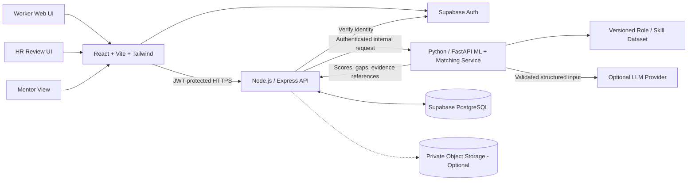

# Second Act — System Design

**Version:** Prototype Architecture Proposal  
**Design Principle:** Small, auditable services; deterministic decisions; human control.

---

## 1. Architecture Overview

Second Act is a web-based career-transition platform that helps workers identify transferable skills, discover adjacent career opportunities, understand skill gaps, and create personalized learning pathways. It also provides controlled mentor matching and an HR review interface.

The system uses a React frontend, a Node.js/Express API for authentication and orchestration, and a Python/FastAPI service for skill extraction, semantic retrieval, and deterministic role matching. Supabase provides PostgreSQL storage and authentication.

The MVP does not require a graph database or multiple autonomous agents. The role-skill graph can be represented using relational tables and queried through SQL and Python. Additional infrastructure should only be introduced when it provides a measurable improvement in functionality, performance, or reliability.

### Architecture Diagram

### Component Responsibilities

- **Frontend:** Collects user information, displays skill evidence and recommendations, supports corrections, and presents learning plans. It must not enforce authorization or calculate authoritative fit scores.
- **Supabase Auth:** Handles user registration, login, session management, and identity verification. A custom password system is unnecessary.
- **Express API:** Acts as the main application entry point. It verifies JWTs, validates requests, checks profile ownership and consent, manages database operations, and coordinates calls to the matching service.
- **FastAPI service:** Performs skill normalization, optional embedding-based retrieval, deterministic role ranking, gap analysis, and structured result validation. It should remain private or accessible only through an authenticated internal connection wherever deployment permits.
- **PostgreSQL:** Stores profiles, skills, role requirements, recommendations, learning resources, assessments, mentor information, opportunities, consent records, and audit events.
- **Optional LLM:** Assists with structured skill suggestions or explanation wording. It must not independently assign verified skills, modify fit scores, access unrestricted database records, or execute external actions.
- **Optional object storage:** Stores uploaded CVs only when required. Use a private bucket with short-lived signed URLs and appropriate access checks. Pasted text and seeded profiles are sufficient for the initial MVP.

### Request Flow

1. The worker signs in through Supabase Auth.
2. The frontend sends an authenticated request to Express with the user's access token.
3. Express verifies the token and checks whether the user is authorized to access the requested resource.
4. For skill extraction or matching, Express sends the minimum required data to FastAPI.
5. FastAPI returns structured results containing skill claims, evidence references, scores, gaps, and relevant version identifiers.
6. Express validates and persists the result, then returns the response to the frontend.
7. The frontend displays the result with its evidence, limitations, and any required user-confirmation steps.

---

## 2. Recommended Deployment for Mentor Evaluation

The prototype should use a simple deployment setup that can be configured and tested reliably within the hackathon timeline.

- **Frontend:** Vercel or another static frontend host.
- **Database and identity:** Supabase PostgreSQL and Supabase Auth. Enable private Storage only if document uploads are required.
- **Express API:** Deploy as a backend service with HTTPS, environment-based configuration, and restricted database credentials.
- **FastAPI service:** Deploy as a separate internal service where supported, or behind a controlled backend entry point. Authenticate requests from Express using a service credential and network restrictions where available.
- **Demo environment:** Use a dedicated project and database containing synthetic worker profiles, mentors, assessments, and opportunities.
- **Configuration:** Maintain separate development and demo environment variables. Store secrets in the hosting provider's secret manager rather than in source code or frontend bundles.

### Deployment Requirements

Before the demo, verify that the frontend can communicate with the API, the API can access the database, and the matching service can be reached only through its intended interface. Add health-check endpoints and controlled timeout handling so a failed service does not leave the application indefinitely loading.

A successful mentor prototype is not automatically production-grade. Before handling real CVs or employer records, conduct security testing, privacy review, retention-policy review, dependency checks, and operational monitoring.

---

## 3. Core Data Model

Use UUID primary keys, timestamps, foreign keys, appropriate uniqueness constraints, and version identifiers. Enforce authorization at the API and database levels wherever practical.

### Main Tables

| Table | Important fields | Purpose |
|---|---|---|
| `profiles` | `id`, `auth_user_id`, `display_name`, `experience_summary`, `preferences_json`, `consent_version`, `created_at`, `deleted_at` | Stores minimal worker identity and preferences |
| `skills` | `id`, `canonical_name`, `definition`, `aliases`, `taxonomy_source`, `taxonomy_version` | Maintains the canonical skill catalogue |
| `worker_skills` | `id`, `profile_id`, `skill_id`, `proficiency`, `status`, `evidence_text`, `evidence_source`, `confidence`, `user_confirmed`, `updated_at` | Stores skill claims and evidence provenance |
| `roles` | `id`, `title`, `domain`, `seniority`, `region`, `source`, `source_version`, `last_verified_at` | Defines target roles and their metadata |
| `role_skill_requirements` | `role_id`, `skill_id`, `importance_weight`, `required_proficiency`, `is_mandatory`, `evidence_rubric`, `source` | Defines role requirements and their importance |
| `recommendations` | `id`, `profile_id`, `role_id`, `fit_score`, `score_breakdown_json`, `critical_gaps_json`, `unknowns_json`, `constraints_json`, `dataset_version`, `scoring_version`, `created_at` | Stores reproducible role recommendations |
| `learning_resources` | `id`, `skill_id`, `title`, `url`, `format`, `cost_band`, `source_checked_at`, `verified` | Stores reviewed learning resources |
| `assessments` | `id`, `skill_id`, `task`, `rubric_json`, `pass_threshold`, `version` | Defines structured skill assessments |
| `assessment_results` | `id`, `profile_id`, `assessment_id`, `result`, `rubric_scores_json`, `evidence_ref`, `reviewer_type`, `created_at` | Records assessment outcomes and evidence |
| `mentor_profiles` | `id`, `display_name`, `skill_ids`, `role_experience`, `languages`, `availability`, `capacity`, `verification_status`, `is_synthetic` | Stores demo or consented mentor information |
| `mentor_requests` | `id`, `profile_id`, `mentor_id`, `shared_fields`, `consent_at`, `status`, `created_at` | Tracks consent-based mentorship requests |
| `opportunities` | `id`, `role_id`, `employer`, `location`, `salary_range`, `source_url`, `source_type`, `last_checked_at`, `status`, `is_simulated` | Stores vacancies separately from general role definitions |
| `consent_events` | `id`, `profile_id`, `purpose`, `consent_version`, `granted`, `created_at`, `revoked_at` | Maintains a history of consent decisions |
| `audit_events` | `id`, `actor_id`, `subject_profile_id`, `action`, `object_type`, `object_id`, `timestamp`, `metadata_minimal` | Records security-sensitive actions without unnecessary personal data |
| `outcome_events` | `id`, `profile_id`, `event_type`, `event_date`, `consent`, `evidence_ref` | Optionally tracks consented application, interview, and offer outcomes |

### Data Integrity and Modelling Rules

- **Unknown is not zero:** An unverified skill must be represented as unknown rather than automatically treated as a lack of ability.
- **Evidence before verification:** An LLM-generated statement must not become a verified skill without user confirmation, assessment evidence, or another documented verification process.
- **Preserve provenance:** Keep source text references separate from normalized skill IDs so recommendations can be traced back to their evidence.
- **Version changes:** Record taxonomy, role dataset, and scoring versions so past recommendations can be reproduced and compared.
- **Separate concepts:** Store role requirements, actual vacancies, and market-demand signals independently.
- **Protect mentor information:** Keep private mentor contact details separate from fields visible to workers.
- **Label synthetic records:** Every simulated profile, mentor, opportunity, and result must be identifiable in the database and interface.
- **Enforce referential integrity:** Use foreign keys and uniqueness constraints to prevent duplicate mappings and invalid references.
- **Support deletion:** Define how profile deletion or anonymization affects linked evidence, recommendations, consent records, and audit history.

---

## 4. Role-Based Access Model

Access should be determined by the authenticated actor, the requested resource, the relevant organization or workflow, and any applicable consent. Roles alone must not grant unrestricted access to personal information.

| Role | Permitted access | Must not be allowed |
|---|---|---|
| Worker | Read and update their own profile, skills, preferences, learning plan, assessment results, and consent settings | Read another worker's private profile or mentor-only notes |
| Mentor | Read only the information explicitly shared for a requested or accepted mentorship | Search all workers or view private CV and profile fields by default |
| HR reviewer | Read profiles specifically assigned or authorized for an organization or workflow | Access unrelated profiles, view private notes, or alter skill evidence without provenance |
| Admin | Maintain role and skill catalogues and support configuration under least privilege | Browse personal content without a documented support need and audit trail |
| Service identity | Access only the endpoints and database resources required for its assigned function | Impersonate users broadly or obtain unrestricted database access |

### Authorization Rules

Every API operation must confirm that the authenticated actor is allowed to perform the requested action on the specified profile or organization. A hidden frontend button is not an authorization control.

- Verify resource ownership or assignment on every relevant request.
- Use database row-level security (RLS) as defense in depth.
- Apply field-level restrictions to mentor and HR views.
- Check consent before transmitting profile data to an external party.
- Test both allowed and denied access paths using separate worker, mentor, and HR accounts.
- Never treat possession of a profile UUID as proof of permission.

---

## 5. Main API Surface

Use the `/api/v1` prefix, validated request and response schemas, consistent error formats, and request IDs. Validate incoming data before database writes or calls to the matching service.

| Method | Endpoint | Purpose |
|---|---|---|
| `POST` | `/api/v1/profiles` | Create a profile and record its initial consent state |
| `GET` | `/api/v1/profiles/:id` | Read an authorized profile |
| `PATCH` | `/api/v1/profiles/:id` | Update preferences and experience summary |
| `POST` | `/api/v1/profiles/:id/skills/extract` | Suggest skill claims with supporting evidence |
| `PATCH` | `/api/v1/profiles/:id/skills` | Confirm, edit, or reject suggested skills |
| `POST` | `/api/v1/recommendations/roles` | Calculate and return adjacent-role recommendations |
| `GET` | `/api/v1/roles/:id` | Read role information and skill requirements |
| `GET` | `/api/v1/roles/:id/gaps?profileId=...` | Return evidence-backed skill gaps |
| `POST` | `/api/v1/learning-plans` | Create a targeted plan from selected gaps |
| `GET` | `/api/v1/mentors/matches?profileId=...` | Return compatible mentors without sharing the profile |
| `POST` | `/api/v1/mentorships` | Request mentorship and record explicitly shared fields |
| `POST` | `/api/v1/assessments/:id/results` | Submit a rubric-based assessment result |
| `GET` | `/api/v1/opportunities` | Retrieve sourced opportunities with freshness and simulation labels |
| `POST` | `/api/v1/profiles/:id/share-approval` | Record explicit approval for external sharing |
| `POST` | `/api/v1/reviews/:id/appeal` | Request human review or correction |
| `GET` | `/api/v1/audit/:profileId` | Read audit history when authorized |

### API Behaviour

- Return appropriate HTTP status codes and avoid exposing internal stack traces.
- Use request validation to reject malformed IDs, invalid proficiency values, oversized inputs, and unsupported fields.
- Apply rate limits to extraction, matching, and other computationally expensive operations.
- Require idempotency protection for actions that could create duplicate requests or records when retried.
- Avoid returning private fields that the requesting actor does not need.
- Keep response schemas consistent between the Express API and FastAPI service.

For a short hackathon, implement only the endpoints required by the live demonstration while keeping endpoint names consistent with this design.

---

## 6. Adjacency and Recommendation Algorithm

The recommendation engine identifies roles that make reasonable use of a worker's existing capabilities while accounting for practical constraints and the effort required to close skill gaps. It must provide explanations that can be traced to structured evidence.

### 6.1 Candidate Generation

1. Normalize worker and role skill text against canonical skill IDs, aliases, and curated mappings.
2. Use versioned role-skill requirements to identify plausible adjacent roles.
3. Optionally use `sentence-transformers/all-MiniLM-L6-v2` embeddings to retrieve semantically related skills and roles missed by exact matching.
4. Treat embedding similarity as a candidate-retrieval signal, not proof of proficiency or the final recommendation score.
5. Remove duplicate candidates and exclude roles that clearly violate known hard user constraints.

### 6.2 Deterministic Ranking

1. Apply hard user constraints, such as location or remote preference, minimum salary if specified, training budget, and available learning time.
2. Compare the worker's available proficiency evidence against each role's required proficiency.
3. Calculate a documented weighted skill-fit score using the role's versioned skill requirements.
4. Evaluate mandatory skills independently and record critical blockers.
5. Identify transferable skills, confirmed gaps, unknown requirements, and evidence-quality limitations.
6. Estimate gap effort using the curated learning-resource and task catalogue where sufficient information exists.
7. Rank eligible roles and return the top three with an explanation of their relative suitability.

A possible scoring model is:

\[
\text{Fit Score} =
\frac{\sum_i w_i m_i}{\sum_i w_i}\times 100
\]

Here, \(w_i\) is the importance weight of skill \(i\), and \(m_i\) is a documented match value based on available proficiency evidence and the role's requirement. The implementation must define the match scale explicitly and handle unknown evidence without silently treating it as zero or full proficiency.

Mandatory requirements must be evaluated separately. A high numerical fit score must not hide a mandatory-skill blocker. The interface should clearly distinguish roles that satisfy the configured eligibility rules from roles that have unresolved requirements.

### 6.3 Recommendation Output

Each recommendation should contain:

- Role ID, title, and fit score.
- A score breakdown showing the major contributing skills.
- Transferable skills supported by evidence.
- Confirmed gaps and mandatory-skill blockers.
- Unknown requirements and confidence limitations.
- Applicable user constraints.
- Suggested learning tasks and verified resources.
- Dataset version, scoring version, and recommendation timestamp.

### 6.4 Explanation Generation

Build explanations from computed facts and versioned role requirements. An optional LLM may rewrite those facts into clear, accessible language, but the API must validate its output against an expected schema.

The LLM must not change the score, invent qualifications, fabricate job-market demand, or present uncertain skill claims as verified facts. If the LLM fails or produces invalid output, use a deterministic explanation template.

---

## 7. Security Design and Threat Model

No prototype can be described as unbreakable. The objective is to establish a defensible security baseline, minimize unnecessary data exposure, and document the remaining limitations.

| Threat | Control in MVP |
|---|---|
| Broken object-level authorization / IDOR | Server-side ownership and tenant checks on every request; RLS defense in depth; authorization tests |
| Leaked API keys | Secrets stored in hosting-provider secret storage or environment configuration; no private keys in Git or frontend bundles |
| CV/resume exposure | Synthetic data by default; private storage; short-lived signed URLs when uploads are required |
| Malicious or oversized upload | File-type allowlist, size limits, malformed-file rejection, isolated parsing where possible, and no execution of uploaded content |
| Prompt injection in CV/job text | Treat documents as untrusted data; provide no unrestricted tools or database credentials to the model; validate structured output |
| Fabricated skill or job data | Evidence provenance, canonical taxonomy validation, source timestamps, and user review |
| Cross-role data access | Separate worker, mentor, and HR scopes; explicit field-sharing allowlists; negative authorization tests |
| Unauthorized sharing | Explicit approval for each destination and purpose; no automatic applications or referrals |
| Sensitive logging | Log IDs, actions, error codes, and minimal metadata; never log raw CVs, tokens, secrets, or full prompts containing personal data |
| Abuse, scraping, or prompt flooding | Rate limits, input-size caps, timeouts, and restrictions on expensive endpoints |
| Unsafe model dependency | Pin dependencies, scan packages, isolate the model/provider behind an interface, and maintain deterministic fallbacks |
| Untraceable decision changes | Persist scoring version, dataset version, and structured score breakdown |

### Minimum Security Controls Before Mentor Deployment

- HTTPS for all public connections.
- Supabase Auth or another established authentication provider, with server-side token verification.
- Object-level authorization checks on every protected operation.
- Strict CORS allowlist, request validation, rate limiting, input-size limits, and safe error responses.
- Explicitly tested Supabase RLS policies for worker, mentor, and HR access.
- Least-privilege credentials between Express and FastAPI.
- Secret scanning and `.env` files excluded from version control.
- Synthetic data in the public demo.
- Informed consent and a documented deletion/retention path for any real-user testing.
- Explicit approval before external profile sharing.
- Basic dependency/security scans and manual access-control tests before sharing the application URL.

---

## 8. Reliability and Observability

The application should remain usable when optional AI services are unavailable. Core recommendation logic must not depend on successful LLM responses.

- Set timeouts and controlled error handling for LLM, embedding, and internal service calls.
- If AI extraction fails, allow manual skill entry and continue deterministic matching with the available profile.
- Cache embeddings by canonical skill or role text and dataset version when embeddings are enabled.
- Make recommendation generation reproducible for identical inputs and versions, and store a `recommendation_id`.
- Use request IDs and structured error logs without including raw profile text.
- Track service health, latency, exception rates, failed authorization attempts, and LLM token/cost usage where applicable.
- Avoid repeated external calls when the same validated input and model version can safely reuse a result.
- Keep synthetic fixtures and automated tests in the repository; never commit real CVs.
- Provide clear frontend error states for unavailable services, incomplete profiles, and failed requests.

The prototype should distinguish a genuine zero-result outcome from a service failure so that users are not misled into believing no suitable roles exist.

---

## 9. Test Strategy

Testing should verify not only whether the application works, but also whether recommendations are reproducible, evidence-backed, and protected by the intended access controls.

1. **Unit tests:** Skill normalization, scoring formula, mandatory-skill blockers, hard constraints, unknown-versus-missing behavior, mentor matching, and assessment update rules.
2. **API tests:** Missing or invalid tokens, unauthorized profile IDs, revoked consent, malformed input, rate limits, incorrect content types, and unsupported methods.
3. **Integration tests:** React → Express → FastAPI → PostgreSQL using seeded synthetic data.
4. **Data-integrity tests:** Foreign-key constraints, duplicate prevention, valid taxonomy references, version tracking, and reproducible database resets.
5. **Fairness smoke tests:** Change irrelevant demo attributes, such as names or prestige-like fields, and confirm that recommendations remain unchanged when those attributes are not intended scoring inputs.
6. **Prompt robustness tests:** Include instructions in CV or job text that attempt to override model behaviour; confirm that outputs remain schema-validated and untrusted claims require review.
7. **Consent and privacy tests:** Verify that mentors and HR reviewers receive only authorized fields and that revoked consent blocks future sharing where applicable.
8. **Assessment tests:** Confirm that an assessment updates only the skill or proficiency it actually evaluates and does not automatically mark unrelated skills as verified.
9. **Release demonstration:** Reset the database, sign in using each test role, run the exact user journey, and show clear mock/live labels.

Before release, run the repository's existing test, lint, type-check, and build commands rather than assuming a particular package manager or script structure.

---

## 10. SAP Integration Boundary

Create a clean adapter interface for worker profiles, role information, and authorized opportunities. This keeps the prototype independent of a specific SAP product and makes future integration easier to test.

For the MVP, use mock JSON payloads and label them clearly in the interface. Keep the adapter separate from core recommendation logic so that simulated data can later be replaced without rewriting the matching engine.

A genuine SAP integration should only be described as implemented after:

1. Confirming the exact SAP product and supported API.
2. Obtaining appropriate access to a test tenant.
3. Configuring authentication and the minimum required permissions.
4. Executing and validating a real authorized operation.
5. Handling errors, timeouts, and unavailable records.
6. Documenting data access, consent requirements, and integration limitations.

Do not imply native SAP SuccessFactors or Joule integration based solely on a mock adapter or sample payload.

---

## 11. Implementation Priorities

The system should be built in an order that reduces integration risk and preserves the most important product capabilities.

**Priority 1 — Core foundation:** Repository setup, environment configuration, database migrations, synthetic seed data, authentication, and authorization.

**Priority 2 — Explainable matching:** Canonical skills, curated role requirements, evidence-backed skill extraction, deterministic scoring, mandatory-skill checks, and role recommendations.

**Priority 3 — Worker journey:** Skill correction, gap analysis, targeted learning plans, assessments, and before/after recommendation comparisons.

**Priority 4 — Controlled collaboration:** Mentor matching, explicit consent, authorized HR review, opportunity freshness labels, and human correction requests.

**Priority 5 — Hardening and demonstration:** Automated tests, security checks, service health handling, deployment, and a reproducible end-to-end demo.

If time is limited, defer optional LLM wording, embeddings, advanced HR dashboards, mentor scheduling, and UI polish. Do not remove authorization, consent, deterministic scoring, mandatory-skill checks, evidence distinctions, or synthetic-data labels.

---

## 12. Definition of Done

The prototype is ready for mentor evaluation when:

- A clean database reset and seed operation completes successfully.
- A worker can create or load a profile and review extracted skill claims.
- Skill claims retain evidence and distinguish confirmed, inferred, and unknown information.
- The matching engine returns reproducible, explainable role recommendations.
- Mandatory requirements and hard user constraints are handled explicitly.
- The worker can identify gaps, follow a learning plan, and compare recommendations after new assessment evidence.
- Assessment results affect only the skills they actually test.
- Mentor and HR views respect authorization and explicit sharing permissions.
- Simulated opportunities, mentors, and integration responses are clearly labelled.
- Core flows and important security boundaries have automated tests.
- The application can be deployed and demonstrated using the documented setup.
- The team can clearly explain which components are real, simulated, optional, and not yet production-ready.

**Final design principle:** Second Act should help workers make informed career decisions by showing what they already bring, what remains uncertain, and what they can do next. Recommendations must remain explainable, privacy-conscious, and subject to human choice.
