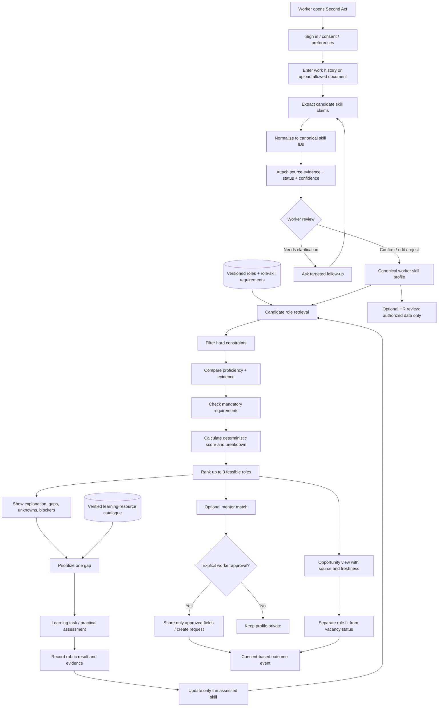

# Second Act — End-to-End Data Flow

**Core loop:** Skill evidence → feasible roles → verified gaps → demonstrated progress → optional mentor/opportunity connection.

---

## 1. System-level flow



## 2. Detailed data flow by stage

### Stage 0 — Identity, consent, and constraints

**Input:** authenticated account, consent choices, preferences, constraints.  
**Process:** the Express API verifies identity; validates the payload; stores minimum required fields; captures the consent purpose/version and timestamp.  
**Output:** profile ID, consent record, current preference set.

Constraints may include location/remote preference, minimum acceptable salary where supplied, learning time, training budget, shift constraints, and preferred role families. Missing optional fields remain unknown rather than receiving made-up defaults. Non-negotiable constraints are applied before role ranking.

### Stage 1 — Skill discovery

**Input:** work-history/resume text and optional structured experience fields.  
**Process:**

1. Enforce input-size limits and treat the text as untrusted content.
2. Run taxonomy alias/phrase matching and, if enabled, schema-constrained LLM extraction.
3. Return candidate skill names, canonical IDs, source evidence spans, confidence/provenance, and clarification questions.
4. Validate returned IDs/names against the canonical catalogue; reject malformed or unsupported output.
5. Store candidate claims as `inferred` or `self_reported`, not `verified` by default.

**Output:** reviewable candidate skill list with evidence. The model never has direct permission to update role rankings, share a profile, or execute external actions.

### Stage 2 — Worker review and canonical profile

**Input:** candidate skills and evidence list.  
**Process:** worker confirms, edits, or rejects skills. The system preserves the original claim and the correction in the audit history, updates the canonical worker skill record, and distinguishes `unknown` from `not_demonstrated`. User correction takes precedence over an unreviewed inference.

**Output:** canonical worker skill profile with per-skill status, proficiency level/rubric, evidence pointer, and update timestamp.

### Stage 3 — Role/skill knowledge base

**Input:** versioned occupation taxonomy and curated project role data.  
**Process:** import selected role and skill records; map source identifiers to project identifiers; record source, version, importance weight, expected proficiency, mandatory flag, and review status. Job-market demand or vacancy data is stored separately with source and checked time.

**Output:** a reproducible role-skill requirement graph represented by relational records. A separate graph database is not required for the prototype.

### Stage 4 — Adjacency calculation

**Input:** canonical worker profile, role requirements, user constraints, scoring-rule version.  
**Process:**

1. Candidate-generation step uses canonical overlap, and optionally embedding similarity, to find plausible roles.
2. Apply hard constraints; store why a role was filtered.
3. For each requirement, compare recorded proficiency with required proficiency and account for evidence status.
4. Compute the transparent estimated skill-fit score.
5. Check mandatory requirements independently.
6. Compile transferable evidence, critical gaps, unknowns, and any unmet constraints.
7. Rank the remaining roles and select up to three.

**Output:** recommendation records with score breakdown, blockers, dataset version, scoring version, and explanation fields. Identical versioned inputs must give identical ranking results.

### Stage 5 — Explanation and transition plan

**Input:** computed recommendation fields, confirmed gaps, resource catalogue, worker preferences.  
**Process:** rules select a priority gap by role importance, gap size, and feasible next action. A curated resource or fixed practical task is attached. An optional LLM can simplify the wording using only this structured input; generated text is checked against the computed fields and cannot invent URLs, credentials, salaries, or vacancies.

**Output:** a focused learning step, a practical task/assessment, and an explanation of why that task matters for the selected role.

### Stage 6 — Skill verification and feedback

**Input:** assessment attempt, rubric, result/evidence.  
**Process:** score using the defined rubric or reviewer result; persist the assessment version and outcome; update only the skill(s) measured. A course viewed/completed is stored as learning progress, not competence verification. Failed or incomplete evidence sets an appropriate status without claiming the worker cannot ever learn the skill.

**Output:** new assessment record, updated skill status/proficiency, updated role ranking, and traceable before/after explanation.

### Stage 7 — Mentor, opportunity, and HR connection

**Mentor matching:** rank synthetic/verified mentor profiles by gap coverage, relevant experience, availability/capacity, language, and session format. Show the basis. No profile data is shared until the worker explicitly approves the requested fields and destination.

**Opportunity validation:** show a vacancy only when a permitted source record exists and has a source URL, observation/checked timestamp, and status. If using mock records, label them simulated. “This role may fit” is not the same as “a vacancy is open.”

**HR view:** expose only profiles and fields authorized for the HR workflow. Recommendations are advisory; HR cannot use the score as an automatic layoff/exclusion decision. Any real SAP exchange requires a separately authorized and tested integration.

**Outcome feedback:** optional events such as mentor request, application, interview, offer, acceptance, or retention may be collected only with appropriate notice and consent. A course completion alone must not be treated as an employment outcome.

## 3. Trust/provenance record for each skill

Each skill record should be explainable using these fields:

- `skill_id` and canonical label
- `status`: `self_reported`, `inferred`, `verified`, `unknown`, or `not_demonstrated`
- `proficiency_level` and the rubric used to assign it
- `evidence_source_type`: work-history text, user confirmation, credential, work sample, assessment, or reviewer
- `evidence_reference`: ID/pointer, not a copy of the entire resume
- `evidence_snippet`: minimum excerpt necessary for explaining the match, with privacy access controls
- `confidence` and confidence-generation method if used
- `reviewed_by_user` / `reviewed_at`
- `taxonomy_version`, `model_version`, and `updated_at`

Never label a skill `verified` solely because the skill is plausible for the worker's previous job title or because an embedding score is high.

## 4. Data flow for the fit score

The scorer receives a versioned worker-skill record and role-skill requirements. A simple, documented baseline is:

`fit_score = 100 × sum(w_i × min(p_i / q_i, 1) × e_i) / sum(w_i)`

Where:

- `w_i` = documented importance weight of requirement `i`.
- `q_i` = required proficiency, normalized to a positive 0–1 scale.
- `p_i` = worker proficiency evidence, normalized to 0–1 when known.
- `e_i` = documented evidence factor reflecting the status/source (the exact values are configuration and must be stated in the demo).

Unknown proficiency contributes no demonstrated evidence in this conservative baseline but is reported as unknown, not as an established absence. If `q_i` is zero/invalid, treat the role record as a data error and do not compute a misleading score. If all role weights are invalid or zero, return a validation error rather than a result. Mandatory blockers are computed in a separate gate, not averaged into the score. The result is an illustrative skill-fit measure, not a probability of receiving a job.

## 5. Security and privacy through the flow

- Verify authentication and object-level authorization before reading or updating profile data.
- Use database row-level security as an additional barrier.
- Never allow a client-supplied profile ID alone to grant access.
- Keep resumes and work samples private; prefer seeded/pasted synthetic data for the public prototype.
- If file uploads are enabled, enforce type and size limits, parse safely, and use short-lived signed URLs.
- Do not log raw resume text, access tokens, full prompts with personal details, or secret values.
- Treat user text and job descriptions as untrusted input to the LLM; validate output against a schema.
- No external sharing, referral, or application without explicit user approval.
- Keep worker-private notes separate from mentor and HR views.
- Provide clear reset/deletion procedures for demo data and define retention before real-user testing.

## 6. Failure paths and expected fallback

| Failure | Required behaviour |
|---|---|
| LLM unavailable | Allow manual entry/taxonomy matching and continue deterministic ranking |
| No skill evidence found | Ask the worker to add work history or select skills; do not invent claims |
| Ambiguous skill phrase | Mark as inferred/unknown and request confirmation |
| No feasible role after constraints | Explain the constraints and show what can be adjusted; do not force an unsuitable role |
| Mandatory requirement unverified | Display the blocker clearly and give a verification/learning action |
| No current vacancy source | Show role pathway and label vacancy as not verified |
| No mentor available | Offer self-guided task/peer route and say no suitable mentor was found in the available dataset |
| Assessment incomplete | Preserve status as needs validation; do not award verified proficiency |
| Unauthorized profile request | Deny access, return safe error, and record minimal audit metadata |
| Malformed/oversized input | Reject with a clear validation message; do not send to the model |
| SAP credentials/API unavailable | Use mock adapter and label it; never claim a real integration |

## 7. API request/response examples

### Skill extraction response (illustrative)

```json
{
  "profile_id": "demo-profile-001",
  "taxonomy_version": "project-taxonomy-v1",
  "candidate_skills": [
    {
      "skill_id": "skill-test-case-design",
      "canonical_name": "Test case design",
      "status": "inferred",
      "evidence_snippet": "Designed regression test cases for banking workflows",
      "evidence_source_type": "work_history_text",
      "confidence": 0.78,
      "needs_user_review": true
    }
  ]
}
```

This is sample structure, not a claim that the example data has been evaluated. The API must validate confidence range, skill ID, status enum, evidence length, and profile authorization before persisting.

### Recommendation response (illustrative)

```json
{
  "profile_id": "demo-profile-001",
  "dataset_version": "roles-demo-v1",
  "scoring_version": "fit-v1",
  "recommendations": [
    {
      "role_id": "qa-automation-engineer",
      "role_fit_score": 64.0,
      "score_type": "estimated_skill_fit_not_hiring_probability",
      "critical_gaps": ["automation-scripting"],
      "unknowns": ["ci-cd-experience"],
      "mandatory_blockers": [],
      "transferable_evidence": ["test-case-design", "defect-triage"],
      "vacancy_status": "not_verified"
    }
  ]
}
```

Numbers and IDs above are illustrative placeholders; the implementation must compute values from the current dataset and must never hard-code the example score.

## 8. Final data-flow acceptance checklist

- [ ] Input → extracted skills → user review → canonical profile works.
- [ ] Each suggested skill has provenance or is clearly marked uncertain.
- [ ] Same profile/dataset/scoring versions produce the same ranked roles.
- [ ] Constraints are filtered before ranking.
- [ ] Mandatory requirements are separate from weighted score.
- [ ] Unknown, absent, self-reported, inferred, and verified states remain distinct.
- [ ] A practical assessment updates only the skill it tests.
- [ ] Opportunity status always carries source/freshness or a simulation label.
- [ ] Mentor/HR sharing requires authorization and relevant consent.
- [ ] LLM failure does not block the basic workflow.
- [ ] Error paths do not expose secrets or personal data.
