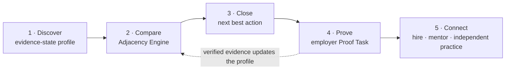

<div align="center">

# Second Act

**The nearest role, not the hardest restart.**

An explainable career-transition engine that turns hidden work experience into verified, hireable evidence.

HackShift 2026 · Entrepreneurship & Employment · Team Maniac Coders

</div>

---

> **Status:** hackathon build in progress — see the [MVP checklist](#mvp-checklist).
> All demo profiles, mentors and employers are **synthetic and labelled as such**.

## Contents

- [Why this exists](#why-this-exists)
- [How it works](#how-it-works)
- [The Adjacency Engine](#the-adjacency-engine)
- [Proof Tasks](#proof-tasks)
- [Who it serves](#who-it-serves)
- [Business model](#business-model)
- [Architecture](#architecture)
- [Getting started](#getting-started)
- [Testing](#testing)
- [Responsible AI and privacy](#responsible-ai-and-privacy)
- [Roadmap](#roadmap)
- [MVP checklist](#mvp-checklist)
- [Team](#team)
- [References](#references)

---

## Why this exists

Indian IT is hiring again, but for different profiles. People whose mid-career roles were restructured — like a 39-year-old manual QA tester with 14 years of banking-domain experience — get filtered out by keyword screens. They can't tell which nearby roles are realistic or which gaps actually matter. Employers, meanwhile, can't trust résumés that AI can polish and interviews that AI can coach.

That is a two-sided problem, and Second Act works on both sides:

| Side | Problem | What Second Act does |
|---|---|---|
| Worker | **Translation** — experience is real but illegible to keyword hiring | Maps what the worker can show to what nearby roles require, and separates *supported*, *claimed* and *missing* skills |
| Employer | **Trust** — résumés and remote interviews are easy to game | Lets employers verify readiness through a short, paid **Proof Task** that produces a **Verified Work Record** |

Workers never pay. Employers pay only when they hire, below typical agency rates.

## How it works



| Stage | What happens | Who acts |
|---|---|---|
| **1. Discover** | Work history becomes structured skill claims. Each claim carries an evidence state and a quote from the source text. The worker confirms or corrects every claim. | Worker + LLM extraction |
| **2. Compare** | The Adjacency Engine ranks nearby roles with two scores (Supported fit and Possible fit), a readiness gate for mandatory requirements, and a durability badge. | Deterministic engine |
| **3. Close** | The engine picks the next best action: *prove* an unverified skill (largest jump in Supported fit) or *learn* a missing one (in prerequisite order). | Engine + worker |
| **4. Prove** | An employer posts a 2–6 hour real task with a rubric. The worker submits (AI use allowed and declared), then a 10-minute structured debrief follows. A Verified Work Record is issued. | Employer + worker |
| **5. Connect** | Hire request (the only paid event), mentor match, or the independent-practice lane. Nothing leaves the platform without the worker's approval. | Worker decides |

## The Adjacency Engine

The engine is deterministic code. The LLM never computes, adjusts or invents a score.

### Proficiency scale

One scale everywhere: **0** None · **1** Aware · **2** Practiced · **3** Independent · **4** Expert.

### Evidence states

| State | Meaning | Counts toward Supported fit | Counts toward Possible fit |
|---|---|---|---|
| `verified` | Confirmed by a reviewed Proof Task or a checked credential | Yes | Yes |
| `evidenced` | A quote in the work history supports it — the quote must match the source text verbatim | Yes | Yes |
| `self_reported` | The worker says so; no supporting text | No | Yes |
| `inferred` | Suggested by related evidence; not yet confirmed | No | Yes |
| `unknown` | Not mentioned — which is **not** the same as "doesn't have" | No | Yes (optimistic bound) |
| `missing` | Confirmed absent (worker says no, or a failed review) | No | No |

### Scores

For a role *r* with requirements *i* (importance weight $w_i$, required level $q_i \ge 1$) and the worker's level $m_i$. Here "claimed" means `self_reported` or `inferred`:

$$
\text{Supported}(r) = 100 \cdot \frac{\sum_i w_i\, s_i}{\sum_i w_i},
\qquad
s_i =
\begin{cases}
\min(1,\ m_i/q_i) & \text{verified or evidenced}\\
0 & \text{otherwise}
\end{cases}
$$

$$
\text{Possible}(r) = 100 \cdot \frac{\sum_i w_i\, p_i}{\sum_i w_i},
\qquad
p_i =
\begin{cases}
\min(1,\ m_i/q_i) & \text{verified, evidenced or claimed}\\
1 & \text{unknown}\\
0 & \text{missing}
\end{cases}
$$

Both are **estimated skill-fit scores, not hiring probabilities**. Supported fit is always ≤ Possible fit, and the gap between them is exactly what verification could change.

Every role uses the same requirement template: **6–8 requirements** drawn from one shared skill list, so a role can't score higher just because it was described with fewer requirements.

### Readiness gate

Mandatory requirements are judged outside the score:

| Gate status | Rule |
|---|---|
| **Cleared** | Verified or evidenced at or above the required level |
| **Needs proof** | Only claimed, or unknown |
| **Gap** | Missing, or best known level below the required level |

A role with any **Gap** is **Blocked**. It moves to "Stretch roles" with a learning path, however high its scores are.

### Ranking

1. Remove roles that break a hard constraint: location or remote preference, salary floor (only where salary data exists), weekly learning time, and employee vs independent preference.
2. Sort feasible (not Blocked) roles by Supported fit, then Possible fit.
3. Show the top three. List Blocked roles separately as Stretch roles.
4. Show a **durability badge** next to each role: a sourced demand signal and an automation-exposure note. The badge is never mixed into the score.

### Next best action

- **Prove**: the unverified requirement with the largest possible jump in Supported fit, $\Delta_i = 100 \cdot w_i\,(p_i - s_i) / \sum_j w_j$.
- **Learn**: gaps in prerequisite order from the skill graph — for example, programming fundamentals → test automation scripting → CI/CD basics.

### Worked example — demo dataset v1, computed by the engine

Harpreet is a composite persona: 39 years old, with 14 years of manual QA on banking software.

| Role | Supported | Possible | Readiness |
|---|---:|---:|---|
| UAT Lead (Fintech) | 75.0 | 100.0 | Clear |
| Business Analyst (BFSI) | 62.1 | 100.0 | Clear |
| Independent UAT Consultant ¹ | 60.9 | 82.6 | Clear |
| QA Automation Engineer (BFSI) | 62.1 | 81.6 | **Blocked** — test automation scripting below required level |

¹ Shown only when the worker opts into independent work.

- **Next best action for UAT Lead:** prove *test reporting & metrics* (+10.7 Supported).
- **After one Proof Task:** the task is a UAT sign-off report for a UPI refund flow. It verifies reporting and compliance awareness, so UAT Lead moves from **75.0 → 92.9** Supported.
- **Side effect:** the new Verified Work Record lifts Independent UAT Consultant from 60.9 → 78.3.

The original pitch assumed QA Automation was Harpreet's next role. The engine shows it is blocked by a mandatory gap, and finds a nearer role that uses his banking-domain knowledge.

## Proof Tasks

| Element | Rule |
|---|---|
| Size | 2–6 hours, one scoped deliverable, linked to 1–3 skills through a rubric |
| Pay | The employer pays the worker a stipend directly; unpaid "spec work" is not allowed |
| AI use | Allowed and must be declared. The work is judged on the outcome plus the debrief, not on keystrokes |
| Debrief | 10-minute structured debrief: fixed questions anchored to the submission, camera on, identity checked |
| Result | Updates **only** the skills in the rubric; a failed review never raises a level |
| Output | A Verified Work Record: skills and levels, rubric scores, reviewer organisation, date, AI-use declaration, debrief done. The worker controls who sees it |

Practice tasks (free, self-serve) help people learn, but they never mark a skill as verified.

## Who it serves

| The track asks to connect… | Second Act |
|---|---|
| Job seekers | Evidence-state profile, nearest feasible roles, next best action |
| Startups & employers | Post Proof Tasks, review with a rubric, hire on real-work evidence |
| Mentors & alumni | Transition mentors and debrief reviewers (synthetic and labelled in the demo) |
| Recruiters | Consented Verified Work Records instead of keyword résumés |
| Turning ideas into ventures | Independent-practice lane: Proof Tasks become a portfolio and first clients |

## Business model

- **Workers:** free, always.
- **Employers:** Proof Tasks are free to post during the pilot. The stipend goes from employer to worker. The fee is charged **on hire only**: about **6% of first-year CTC**, against typical agency fees of 8.33–16.67% and AI-native agencies at about 7%.
- **Example:** a ₹12 LPA hire earns a ₹72,000 fee.
- **Expansion:** enterprise licences — *Redeploy* (internal mobility before exits) and *Recover* (transition support bundled with severance).

Every number here is a hypothesis to test in the pilot, not a result.

## Architecture

### AI boundaries

| Task | Done by |
|---|---|
| Résumé → structured claims (JSON schema) | LLM |
| Evidence-quote check (verbatim match against source) | Code |
| Skill normalisation (canonical list + aliases) | Code, with optional semantic assist |
| Scores, readiness gate, constraints, ranking, next best action | Code |
| Explanations ("why this role") | Templates filled from computed fields, optionally paraphrased by the LLM |
| Proof Task review | Human reviewer with a rubric |
| Sharing, applying, hiring | Worker approval |

### Planned layout

```text
second-act/
├── backend/
│   ├── app/
│   │   ├── main.py            # FastAPI routes
│   │   ├── schemas.py         # pydantic models
│   │   ├── engine/            # scoring.py · ranking.py · prerequisites.py
│   │   ├── extraction/        # LLM extraction · verbatim evidence check · cache
│   │   └── proof/             # proof tasks · reviews · verified work records
│   ├── data/demo-v1/          # skills.csv · roles.csv · role_requirements.csv · profiles/*.json
│   └── tests/
├── frontend/                  # React + Vite
└── docs/                      # team reference PDF · pitch deck
```

### Data model

| Entity | Key fields |
|---|---|
| `Skill` | id, name, aliases, category, prerequisites |
| `Role` | id, title, kind (employee / independent), demand signal + source + date, exposure note + source |
| `RoleRequirement` | role_id, skill_id, weight (1–5), required level (1–4), mandatory |
| `WorkerSkill` | worker_id, skill_id, state, level, evidence quote, source, updated_at |
| `ProofTask` | id, employer, brief, rubric → skill_ids, stipend, time cap |
| `WorkRecord` | worker_id, task_id, skill levels, rubric scores, reviewer, AI-use declaration, debrief_done, date |
| `Consent` | worker_id, recipient, scope, granted_at, revoked_at |

### API

| Method | Path | Purpose |
|---|---|---|
| `POST` | `/api/profiles/{id}/extract` | Extract claims with evidence states (verbatim-checked, cached) |
| `PATCH` | `/api/profiles/{id}/skills` | Worker confirms or corrects claims |
| `POST` | `/api/match` | Ranked roles: scores, readiness, durability, next best actions |
| `GET` | `/api/roles/{id}` | Role requirements and sources |
| `POST` | `/api/proof-tasks` | Employer creates a task with a rubric |
| `POST` | `/api/proof-tasks/{id}/submissions` | Worker submits, with an AI-use declaration |
| `POST` | `/api/submissions/{id}/review` | Rubric review + debrief → Verified Work Record |
| `GET` | `/api/profiles/{id}/records` | The worker's Verified Work Records |
| `POST` | `/api/share` | Consented sharing with an employer or recruiter |

## Getting started

Commands assume the planned layout above.

```bash
# Backend
cd backend
python -m venv .venv && source .venv/bin/activate
pip install -r requirements.txt
cp .env.example .env          # LLM_API_KEY is optional
uvicorn app.main:app --reload

# Frontend
cd frontend
npm install
npm run dev
```

Without an API key, extraction falls back to the cached demo profiles, so the full demo runs offline.

## Testing

```bash
cd backend && pytest
```

| Area | Must hold |
|---|---|
| Engine | Supported ≤ Possible; worked-example values reproduce exactly; `q = 0` and non-positive weights are rejected; Blocked roles never appear in the top three; same profile + same dataset version → same output |
| Extraction | Every evidence quote is found verbatim in the source, or the claim drops to `inferred`; the cache is reused; malformed output falls back to manual entry |
| Fairness | Counterfactual résumés — changed name, graduation year, career gap, college tier, or a plain-English rewrite — yield the same extracted skills and levels; differences are reported, not hidden |
| Proof | A review changes only the rubric's skills; a failed review never raises a level; every record has a reviewer, a date, an AI-use declaration and a debrief flag |
| Privacy | Nothing is shared without consent; no résumé text appears in logs |

## Responsible AI and privacy

- Bias can enter at extraction, so fairness is tested there. The scorer never reads names, age, photos or college.
- Recommendations are decision support. The worker decides, and no application is ever sent automatically.
- Designed for India's Digital Personal Data Protection Act, 2023 and DPDP Rules, 2025, whose substantive duties apply from 13 May 2027: purpose-bound consent, minimal data, deletion on request.
- Synthetic data only in the demo and the repository. Real CVs are never committed.

## Roadmap

| Now (MVP) | Next | Later |
|---|---|---|
| QA / BA / BFSI role family, Proof Tasks, Verified Work Records, consented sharing | Apprentice pods (an experienced lead plus a fresher on one Proof Task), alumni mentor network, more role families | Enterprise *Redeploy* and *Recover* modes, HRMS adapters, outcome tracking with consent |

## MVP checklist

- [ ] Demo dataset v1: skills with prerequisites, 8–12 roles including one independent role, three synthetic profiles
- [ ] Extraction with verbatim evidence check, cache and manual fallback
- [ ] Profile screen with evidence-state chips and edit / confirm
- [ ] Engine: Supported / Possible, readiness gate, constraints, ranking, next best action — with unit tests
- [ ] Role Map screen: top three plus Stretch roles, durability badge
- [ ] Proof Task flow: post → submit → review → Verified Work Record → live recompute
- [ ] Consent and share screen
- [ ] Mentor panel (synthetic, labelled) — optional
- [ ] Demo reset script and offline fallback

## Team

**Team Maniac Coders** — add member names and GitHub handles here.

## References

- TCS headcount FY26 — [The Wire](https://thewire.in/economy/employee-headcount-of-tcs-goes-down-by-23000-in-fy26) · CEO on skill mismatch — [Outlook Business](https://www.outlookbusiness.com/corporate/skill-mismatch-not-ai-tcs-ceo-clarifies-reason-behind-sudden-layoffs)
- Xpheno active tech jobs, Oct 2026 — [Lapaas Voice](https://lapaasvoice.com/tech-jobs-in-india-rise-17-to-1-23-lakh-in-october-highest-in-18-months/) · Indeed India on AI in software-dev postings — [The People's Board](https://www.thepeoplesboard.com/?p=21493)
- Belot et al. (2025), *Advising Job Seekers in Occupations with Poor Prospects* — [NBER w33819](https://www.nber.org/papers/w33819)
- Pallais (2014), *Inefficient Hiring in Entry-Level Labor Markets* — [NBER w18917](https://www.nber.org/papers/w18917)
- Sackett et al. (2022), selection-method validity — [summary](https://www.noon.ai/blog/articles/356-structured-interview-validity)
- Hosseinioun et al. (2025), *Skill dependencies uncover nested human capital* — [arXiv](https://arxiv.org/abs/2303.15629v5)
- Candidate fraud (Gartner, via CXOToday) — [link](https://cxotoday.com/top-stories/the-deepfake-candidate-how-ai-is-breaking-the-hiring-process/)
- Recruitment agency fees in India, 2026 — [9cv9](https://blog.9cv9.com/how-much-do-recruitment-agencies-charge-in-india-in-2026/) · [Hyring](https://hyring.com/recruitment-agency)
- DPDP Rules timeline — [Maheshwari & Co](https://www.maheshwariandco.com/blog/dpdp-act-compliance-guide-2025/)

## License

MIT. Add a `LICENSE` file before making the repository public.
